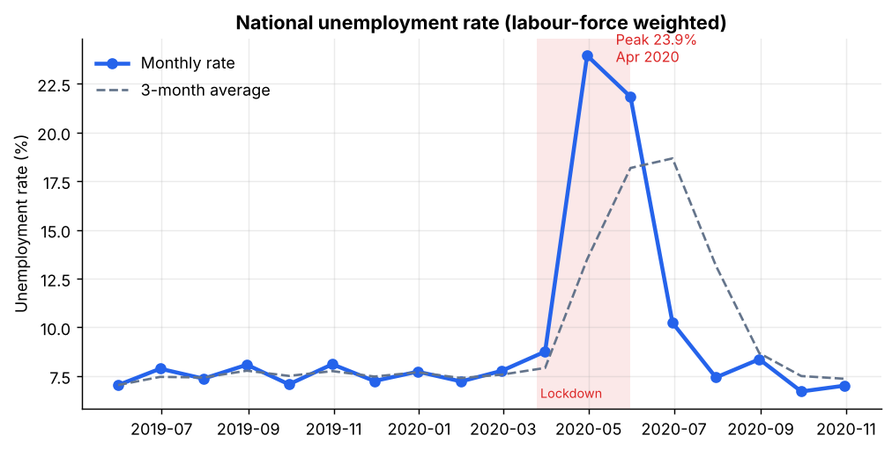
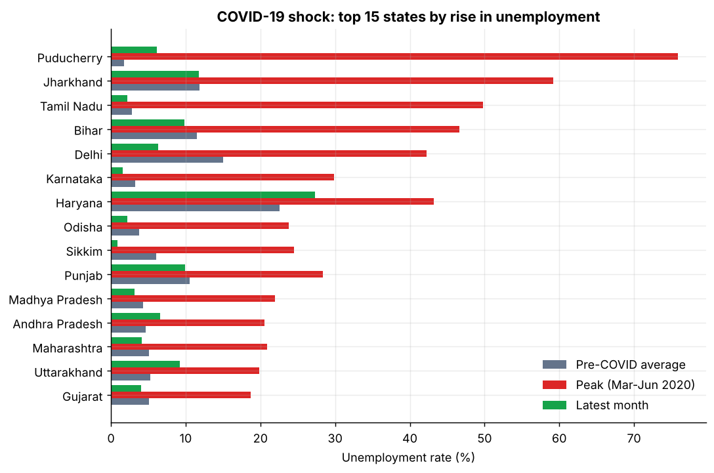
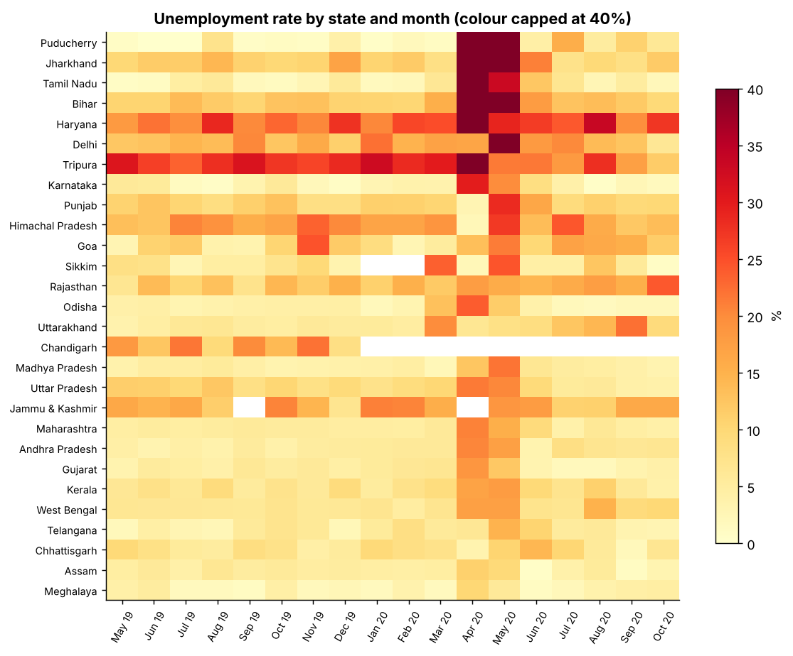

# Unemployment Analysis in India (2019-2020)

> **CodeAlpha Data Science Internship, Task 2:** Unemployment Analysis with Python

An end-to-end data science project that cleans, explores, tests and visualises monthly unemployment data for 28 Indian states and union territories (May 2019 - Oct 2020), with a focus on the impact of COVID-19. It ships as a reusable Python package, a command-line report generator, an executed Jupyter notebook, and an interactive Streamlit dashboard that can be deployed to Render.



---
## Live demo

https://unemployment-analysis-26nx.onrender.com

(Hosted on Render's free plan, so the first load after inactivity can take about 50 seconds. Health check: `/health`.)

## Table of contents

1. [What this project does](#what-this-project-does)
2. [Key findings](#key-findings)
3. [Project structure](#project-structure)
4. [Data and cleaning](#data-and-cleaning)
5. [Methodology](#methodology)
6. [Function reference](#function-reference)
7. [Dashboard features](#dashboard-features)
8. [Getting started](#getting-started)
9. [Testing](#testing)
10. [Deployment (GitHub and Render)](#deployment-github-and-render)
11. [Limitations](#limitations)
12. [Task requirements checklist](#task-requirements-checklist)
13. [License](#license)

---

## What this project does

| Task requirement | How it is covered |
|---|---|
| Data cleaning | Loaders fix whitespace, blank rows, a duplicated header, swapped coordinates and inconsistent frequency labels, then build one harmonised state-level panel |
| Exploration and visualisation | National, regional, state and urban/rural trends, a state x month heatmap and a bubble map (7 static figures and an interactive dashboard) |
| Impact of COVID-19 | Phase analysis, per-state baseline vs peak vs latest, employment loss, recovery share, plus Welch t-test, Mann-Whitney U and Cohen's d |
| Patterns and seasonal trends | Month-over-month change, 3-month rolling average, volatility ranking, and a same-month year-over-year check (see [Limitations](#limitations) for why formal seasonality is not possible) |
| Insights for policy | Insights are generated from the data, so every number quoted always matches the analysis |

## Key findings

Generated by `run_analysis.py` (see [`reports/insights.md`](reports/insights.md)):

- National unemployment averaged **7.6%** before COVID-19, peaked at **23.9% in April 2020**, and was back to **7.0% by October 2020**.
- The lockdown effect is statistically significant: state-month rates were about **13.7 percentage points higher** in Apr-May 2020 than before COVID (Welch p < 1e-7, Cohen's d = 1.11).
- The largest baseline-to-peak shocks were **Puducherry (+74 pp), Jharkhand (+47 pp) and Tamil Nadu (+47 pp)**.
- By October 2020, **18 of 27 states** were at or below their pre-COVID average rate. **Haryana (27.3%) and Rajasthan (24.2%)** were still the highest in October 2020 and above their own pre-COVID levels.
- Urban unemployment ran about **1.9 pp above rural** before COVID and peaked at 25.5% (urban) vs 23.6% (rural) in April 2020.
- Unemployment and labour participation show a negligible relationship across state-months (Spearman rho = -0.06).

| COVID-19 shock by state | Heatmap |
|---|---|
|  |  |

## Project structure

```
CodeAlpha_UnemploymentAnalysis/
├── app.py                      # Streamlit dashboard (deployed to Render)
├── run_analysis.py             # CLI: runs the full analysis, writes reports/
├── requirements.txt            # runtime dependencies
├── requirements-dev.txt        # + pytest and notebook tooling
├── render.yaml                 # Render Blueprint (one-click deploy config)
├── pytest.ini
├── .streamlit/config.toml      # Streamlit server/theme settings
├── data/
│   └── raw/
│       ├── unemployment_in_india.csv            # May 2019 - Jun 2020, Urban/Rural
│       └── unemployment_rate_upto_11_2020.csv   # Jan - Oct 2020, state level + coordinates
├── src/unemployment/
│   ├── config.py               # paths, schemas, COVID phase definitions
│   ├── data.py                 # loading, cleaning, harmonising, quality checks
│   ├── analysis.py             # trends, COVID impact, statistics, insights
│   ├── plots.py                # interactive Plotly figures (dashboard)
│   └── report.py               # static matplotlib figures, CSV tables, insights.md
├── notebooks/
│   └── unemployment_analysis.ipynb   # executed walkthrough
├── reports/
│   ├── insights.md             # auto-generated findings
│   ├── figures/                # 7 PNG charts
│   └── tables/                 # 9 CSV result tables
└── tests/                      # 17 pytest tests (data, analysis, report, dashboard)
```

## Data and cleaning

Two CSV files from CodeAlpha / CMIE are used. Both needed cleaning, and the loaders in `src/unemployment/data.py` handle each issue explicitly:

| Issue found in the raw files | Fix |
|---|---|
| Leading spaces in column headers and values; UTF-8 BOM | `skipinitialspace`, `utf-8-sig`, string stripping |
| `unemployment_in_india.csv` ends with 28 fully blank rows (768 rows, 740 real) | dropped |
| `unemployment_rate_upto_11_2020.csv` has two columns both called `Region` (state, then macro-region) | columns renamed to an explicit schema |
| `longitude` and `latitude` columns are **swapped** (e.g. Andhra Pradesh longitude = 15.9) | detected from value ranges and swapped back, so a corrected file would not be broken |
| Frequency is `Monthly` in one file and `M` in the other | normalised |
| Dates are `dd-mm-yyyy` strings | parsed to datetimes |
| The two files overlap for Jan-Jun 2020 | the state-level file is used where both exist; the overlap is validated (median difference 0.005 pp, about 80% of rows within 0.5 pp) |

**Harmonised panel:** 490 state-month rows, 28 states/UTs, May 2019 - Oct 2020. Some state-months are genuinely absent from the source (for example Chandigarh after Mar 2020, Jammu & Kashmir in Apr 2020); these appear as blanks in the heatmap and are not imputed.

## Methodology

- **Aggregates are labour-force weighted.** Labour force is estimated as `employed / (1 - unemployment_rate)`, so large states count proportionally and small ones do not distort national figures.
- **COVID phases** (month-end observations): Pre-COVID (before Mar 2020), Onset (Mar 2020, lockdown began 25 Mar), Lockdown (Apr-May 2020), Recovery (Jun-Oct 2020).
- **State impact:** baseline = mean Pre-COVID rate; peak = highest rate Mar-Jun 2020; latest = Oct 2020; recovery share = how much of the rise has been unwound.
- **Significance:** Welch's t-test (unequal variances) and the non-parametric Mann-Whitney U test on state-month rates, with Cohen's d for effect size.
- **Urban vs rural** uses the first file only (the only one with an area split).

## Function reference

**`unemployment.data`**

| Function | Purpose |
|---|---|
| `load_state_area()` | Load and clean the Urban/Rural file |
| `load_state()` | Load and clean the state file (fixes headers and coordinates) |
| `collapse_areas()` | Combine Urban and Rural rows into one state-level row per month |
| `build_panel()` | Build the continuous May 2019 - Oct 2020 state panel with COVID phases |
| `add_phase()` | Tag rows with their COVID phase |
| `weighted_rate()` | Labour-force-weighted unemployment rate |
| `validate_overlap()` / `data_quality_report()` | Cross-file consistency and data-quality summary |

**`unemployment.analysis`**

| Function | Purpose |
|---|---|
| `national_trend()` | Monthly weighted rate, month-over-month change, 3-month rolling average |
| `regional_trend()` | Same by macro-region (North, South, East, West, Northeast) |
| `urban_rural_trend()` | Urban vs rural rates and the gap in percentage points |
| `phase_summary()` | Average rate per COVID phase |
| `covid_impact_by_state()` | Baseline, peak, latest, rise and recovery share per state |
| `covid_significance()` | Welch t-test, Mann-Whitney U, Cohen's d |
| `employment_loss()` | Employed persons in Feb 2020 vs the lockdown trough |
| `same_month_yoy()` | 2019 vs 2020 for months observed in both years |
| `state_volatility()` / `state_ranking()` | Volatility and monthly rankings |
| `participation_correlation()` | Spearman correlation of unemployment and labour participation |
| `generate_insights()` | Plain-English insights computed from the data |

**`unemployment.plots`** builds the interactive Plotly charts; **`unemployment.report`** builds the static PNG figures, CSV tables and `insights.md` (`build_report()`).

## Dashboard features

Run it with `streamlit run app.py`. Six tabs and sidebar filters (macro-region and state) that re-compute every aggregate:

1. **Overview:** KPI cards, national trend with the lockdown shaded, phase averages, month-over-month table
2. **COVID-19 impact:** significance test, baseline/peak/latest chart, state impact table, employment loss
3. **States and regions:** state comparison, regional trends, heatmap, monthly ranking, volatility
4. **Urban vs rural:** trends and the gap
5. **Map:** bubble map of state unemployment with a month slider
6. **Insights and data:** auto-generated insights, same-month comparison, data-quality report, CSV download

## Getting started

Requires Python 3.10 or newer.

```bash
git clone https://github.com/<your-username>/CodeAlpha_UnemploymentAnalysis.git
cd CodeAlpha_UnemploymentAnalysis

python -m venv .venv
source .venv/bin/activate          # Windows: .venv\Scripts\activate
pip install -r requirements.txt

python run_analysis.py             # regenerate figures, tables and insights
streamlit run app.py               # open the dashboard at http://localhost:8501
```

For the notebook and tests: `pip install -r requirements-dev.txt`, then `jupyter notebook notebooks/unemployment_analysis.ipynb`.

## Testing

```bash
pip install -r requirements-dev.txt
pytest
```

17 tests cover data cleaning (blank rows, whitespace, swapped coordinates), panel integrity, cross-file consistency, the statistics, report generation, and a headless render of the dashboard.

## Deployment (GitHub and Render)

### 1. Push to GitHub

Create an **empty** repository named `CodeAlpha_UnemploymentAnalysis` (no README, .gitignore or license), then:

```bash
cd CodeAlpha_UnemploymentAnalysis
git init
git add .
git commit -m "Add unemployment analysis project"
git branch -M main
git remote add origin https://github.com/<your-username>/CodeAlpha_UnemploymentAnalysis.git
git push -u origin main
```


## Limitations

- **No formal seasonality.** Only ~18 months of data exist, which is less than two full cycles, so decomposition would be unreliable. The project compares the months present in both years (May, June) and flags the rest as unknowable here.
- **COVID and seasonality are confounded.** The data cannot separate a seasonal movement from the pandemic shock for 2020.
- **Survey estimates.** "Estimated Employed" and rates for small states (for example Puducherry's 75.9% in April 2020) are noisy sample-based figures.
- **Weights are estimated** from employed counts and unemployment rates because raw labour-force counts are not provided.
- **Coverage:** 28 states/UTs, not all of India; some state-months are missing in the source.

##  Author

**Md. Tanjimul Islam** — Data Science Intern at CodeAlpha
GitHub: [md-tanjimul-islam](https://github.com/md-tanjimul-islam)
